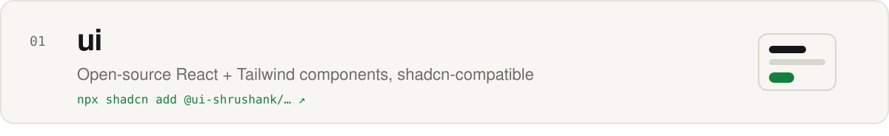
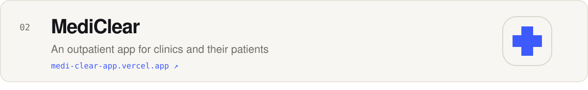
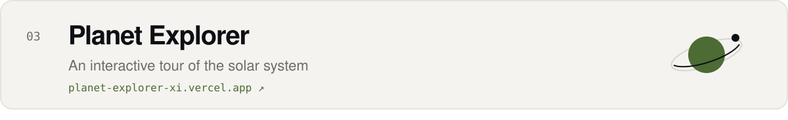
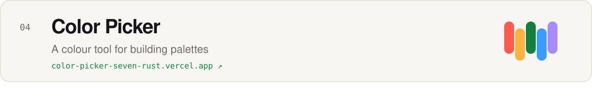

<a href="https://www.shrutishankarnarayanan.com">
<picture>
  <source media="(prefers-color-scheme: dark)" srcset="assets/header-dark.svg">
  
</picture>
</a>

<picture>
  <source media="(prefers-color-scheme: dark)" srcset="assets/section-work-dark.svg">
  
</picture>
<a href="https://github.com/Shrootiiii/ui">
<picture>
  <source media="(prefers-color-scheme: dark)" srcset="assets/project-ui-dark.svg">
  
</picture>
</a>
<a href="https://medi-clear-app.vercel.app">
<picture>
  <source media="(prefers-color-scheme: dark)" srcset="assets/project-mediclear-dark.svg">
  
</picture>
</a>
<a href="https://planet-explorer-xi.vercel.app">
<picture>
  <source media="(prefers-color-scheme: dark)" srcset="assets/project-planet-dark.svg">
  
</picture>
</a>
<a href="https://color-picker-seven-rust.vercel.app">
<picture>
  <source media="(prefers-color-scheme: dark)" srcset="assets/project-color-dark.svg">
  
</picture>
</a>

<picture>
  <source media="(prefers-color-scheme: dark)" srcset="assets/section-tools-dark.svg">
  
</picture>
<picture>
  <source media="(prefers-color-scheme: dark)" srcset="assets/tools-dark.svg">
  
</picture>
